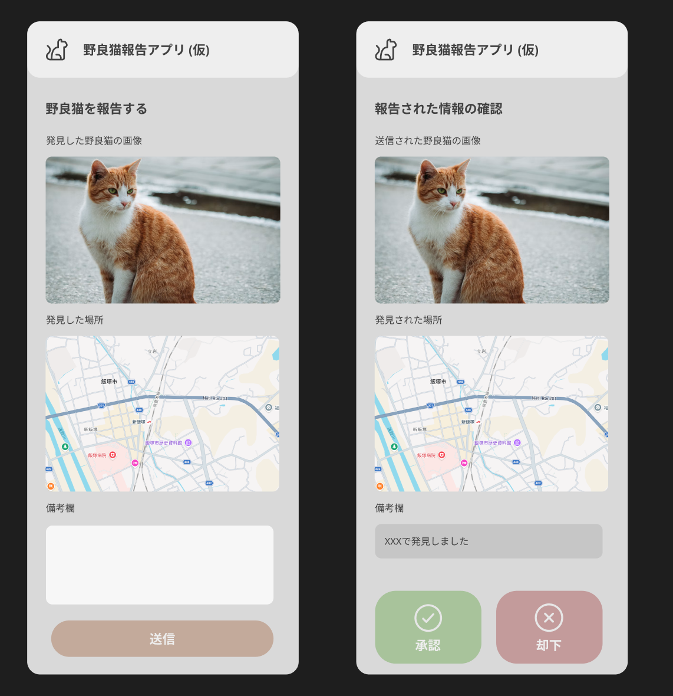
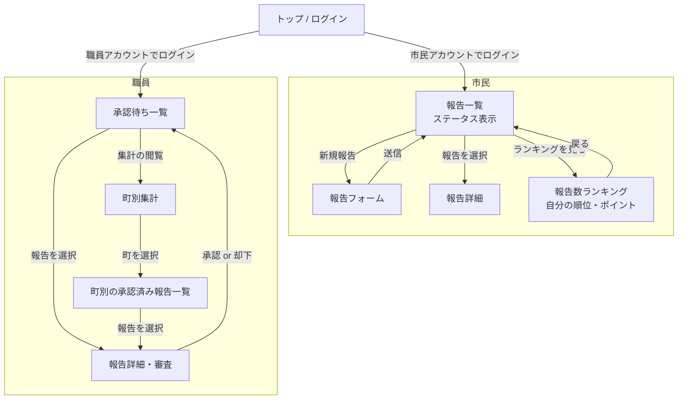
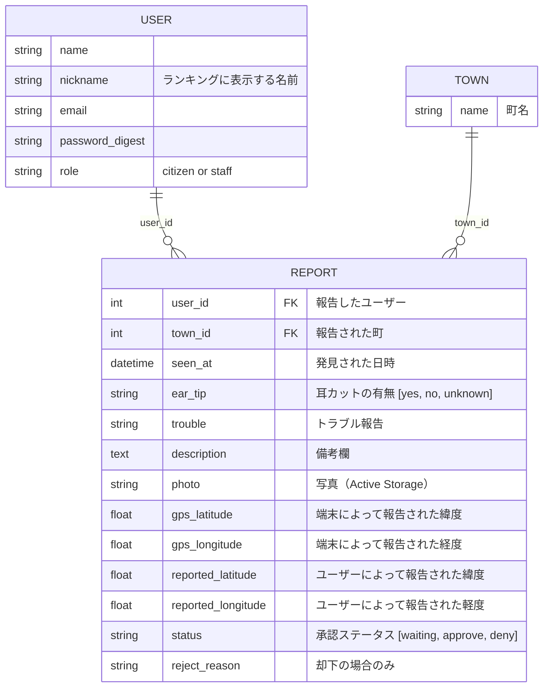

# 基本設計書：野良猫報告アプリ

- チーム番号：チーム01
- メンバー：下城英輝、黒岩陽太

## 課題
- **選んだ課題**：市に寄せられる野良猫の苦情や目撃情報が電話などの管理しづらい状態で届くため、市が「どの町に手術済みの猫と未手術の猫がどれくらいいるか」を把握できず、不妊手術助成金の効果も測定できていない。
- **誰の課題か**: 市の職員 Aさんと報告する側の市民 Bさん
  - **Aさんの場面**：市民から野良猫の電話を受けても、その猫が手術済みかどうかや同じ町からほかに何件来ているかを把握することができない。受け付けた苦情のフォーマットが固定されていないため、助成金で野良猫は減ったかどうかの測定が実施しづらい。
  - **Bさんの場面**：迷惑に感じている野良猫がいるものの、市役所に電話するほどではない上に伝えてもその後の経過が分からない。
- **なぜこの課題を選んだか**：東大阪市は平成30年度から累計3,649匹の不妊手術に助成しているものの、「実態を把握できる現実的な調査手法がない」や「助成金の効果の測定に苦慮している」と報告している。市民の目撃報告を元にデータを集計できれば、助成の効果を測定することができる。現状の固定されたフォーマットが存在しないデータを実際に集計できるデータにするためには報告システムが最も効果的だと考えたため。
- **元になった自治体課題**：[東大阪市「市内に生息する野良猫の生態や飼養管理、被害状況の把握に向けて」](https://www.park.itc.u-tokyo.ac.jp/padit/cog2026/area/kinki.html#higashiosaka-list)（COG2026）

## 0. 考えを整理する3つの問い
- **開発目的**: 市内に生息する野良猫の情報を市民が報告できるようにし、市が野良猫の生息状況を管理できるようにする
- **想定ユーザ**：市の職員、市民
- **機能**：画像や位置情報を添付して野良猫の情報を報告できる機能、市の職員が報告された情報を承認・却下できる機能

## 1. ユーザーストーリー
- ストーリー1：【市の職員】として、野良猫の生息状況を把握したい
- ストーリー2：【市民】として、発見した野良猫の情報を報告したい
- ストーリー3：【市の職員】として、市民から報告された野良猫の情報を承認・却下したい

## 2. 画面イメージ（ワイヤーフレーム）

## 3. ページ遷移図

## 4. データモデル（ER図）

- **関連1**：User:Report (1:many), 外部キー `user_id` を持つ参照元は Report
  - `User has_many :reports` / `Report belongs_to :user`
- **関連2**：Town:Report (1:many), 外部キー `town_id` を持つ参照元は Report
  - `Town has_many :reports` / `Report belongs_to :town`

## 5. 開発着手の許可基準に対する自己チェック
- [x] 課題の具体性：身近な実在のペインに基づいているか？
- [x] 連動性：ユーザーストーリーと画面・データモデルが破綻なく繋がっているか？
- [x] ボリュームの妥当性：第14回までに2名で作りきれる規模感か？
